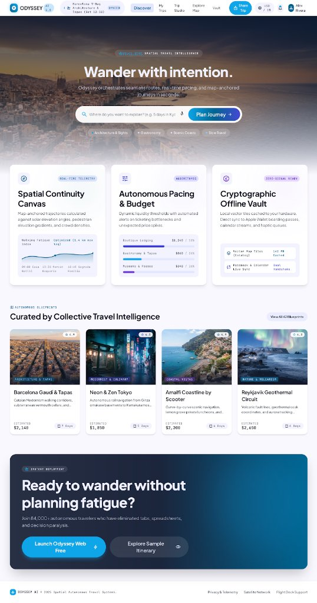

# AiTravelPlanner — Spatial Travel Intelligence

A Next.js (App Router), Tailwind CSS, and DaisyUI frontend for **AiTravelPlanner**, a service that generates personalized, budget-aware, algorithmically paced travel itineraries.



---

## 🚀 Tech Stack

- **Framework**: [Next.js 14](https://nextjs.org/) (App Router, JavaScript)
- **Styling**: [Tailwind CSS](https://tailwindcss.com/) with a custom design system
- **UI Components**: [DaisyUI 4](https://daisyui.com/) with custom `odyssey` theme tokens
- **Typography**: Loaded with `next/font/google`:
  - Primary Display & Sans: **Plus Jakarta Sans**
  - Telemetry & Code: **JetBrains Mono**
- **Icons**: 17 Handcrafted SVG icons in `public/assets/icons/` and `assets/icons/`
- **Linting**: ESLint with `eslint-config-next`

---

## 📁 Project Structure

```
├── assets/                          # Static image and vector asset storage
│   ├── icons/                       # 17 vector SVG icons
│   └── images/                      # Destination photos and placeholders
│       └── placeholders/            # Aspect-ratio matched SVGs
├── public/                          # Next.js public directory
│   └── assets/                      # Production runtime assets
├── src/
│   ├── app/                         # Next.js App Router routes & layouts
│   │   ├── blueprints/              # Blueprints catalog & dynamic [slug] pages
│   │   ├── explore-map/             # Explore Map page
│   │   ├── my-trips/                # My Trips page
│   │   ├── plan/                    # Plan Journey action page
│   │   ├── privacy/                 # Privacy & Telemetry policy
│   │   ├── profile/                 # Explorer profile page
│   │   ├── sample-itinerary/        # Sample itinerary preview
│   │   ├── satellite-network/       # Satellite mesh status
│   │   ├── share-trip/              # Share trip modal route
│   │   ├── support/                 # FlightDeck support
│   │   ├── trip-studio/             # Trip Studio editor
│   │   ├── vault/                   # Cryptographic offline vault
│   │   ├── globals.css              # Global styles & theme utilities
│   │   ├── layout.jsx               # Root layout with shared Header & Footer
│   │   └── page.jsx                 # Home / Discover landing screen
│   ├── components/
│   │   ├── blueprints/              # Blueprint cards & section grid
│   │   ├── capabilities/            # Spatial telemetry, pacing & vault cards
│   │   ├── common/                  # Skeletons, error states, badges, placeholders
│   │   ├── cta/                     # Dark gradient conversion banner
│   │   ├── hero/                    # Hero headline, search bar & filter pills
│   │   └── layout/                  # Shared Header and Footer
│   ├── config/
│   │   ├── api.js                   # API configuration & mock toggle
│   │   └── assets.js                # Centralized asset key mapping
│   ├── data/
│   │   └── mock/                    # Server-shaped mock responses
│   │       ├── activeTrip.js
│   │       ├── blueprints.js
│   │       ├── capabilities.js
│   │       ├── cta.js
│   │       ├── hero.js
│   │       └── user.js
│   └── services/                    # Async service layer abstractions
│       ├── getActiveTrip.js
│       ├── getBlueprints.js
│       ├── getCapabilities.js
│       ├── getCtaData.js
│       ├── getHeroData.js
│       ├── getUser.js
│       └── index.js
├── .env.example                     # Environment variable blueprint
├── jsconfig.json                    # Path aliases (@/* -> ./src/*)
├── package.json
└── tailwind.config.js               # Design tokens & DaisyUI theme
```

---

## 🔌 Decoupled Data Layer

Components **never** import static mock files directly. All data access flows through typed async service functions returning standard `{ data, error, meta }` response objects.

### Switching Between Mock and Real Backend

In `.env.local`:

```env
# Set to 'true' to use simulated mock data with artificial latency (default)
# Set to 'false' to make real HTTP fetch requests to NEXT_PUBLIC_API_BASE_URL
NEXT_PUBLIC_USE_MOCK_API=true

# Real backend API base URL
NEXT_PUBLIC_API_BASE_URL=https://api.aitravelplanner.io/v1
```

Each service method includes JSDoc documentation specifying endpoint paths, request parameters, and response shapes, making it seamless to replace with a real REST or GraphQL backend without touching any UI component.

---

## 🎨 Design System Tokens

- **Brand Palette**:
  - `primary`: `#0284c7` (Sky 600)
  - `accent`: `#0ea5e9` (Sky 500)
  - `dark`: `#0f172a` (Slate 900)
  - `navy`: `#132238` / `#0d1726`
  - `teal`: `#036592`
  - `telemetry`: `#eff6ff` (bg) / `#2563eb` (text)
  - `algorithmic`: `#f5f3ff` (bg) / `#7c3aed` (text)
  - `vault`: `#faf5ff` (bg) / `#9333ea` (text)
- **Radii**: `rounded-pill` (`9999px`), `rounded-card` (`20px`), `rounded-card-lg` (`28px`)
- **Shadows**: Soft layered elevations matching the modern spatial intelligence look.

---

## 🛠️ Getting Started

### 1. Prerequisites
- Node.js `v18+` or `v20+` (tested on Node `v24`)
- npm `v9+` or `v11+`

### 2. Installation
```bash
git clone https://github.com/manish12345p/Ai_travel_planner.git
cd Ai_travel_planner
npm install
```

### 3. Running the Development Server
```bash
npm run dev
```
Open [http://localhost:3000](http://localhost:3000) in your browser.

### 4. Production Build & Lint
```bash
# Run ESLint
npm run lint

# Compile production build
npm run build

# Start production server
npm run start
```

---

## ♿ Accessibility

- Semantic HTML structure (`<header>`, `<main>`, `<nav>`, `<article>`, `<section>`, `<footer>`).
- Ordered heading hierarchy (`h1` → `h2` → `h3`).
- Explicit `<label>` and `sr-only` accessibility text on inputs.
- Keyboard navigation with visible focus indicators (`:focus-visible`).
- Color contrast compliant with WCAG 2.1 AA standards.

---

## 📄 License
MIT © 2025 Spatial Autonomous Travel Systems.
